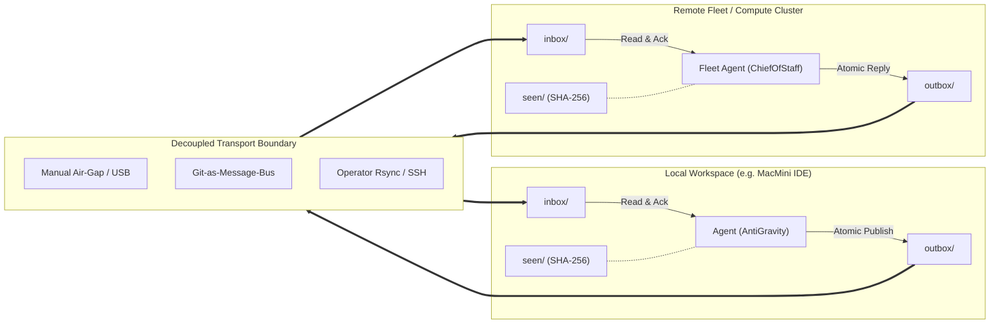

# Agent Mailbox Protocol (AMP)

> **Asynchronous, air-gapped, plain-file coordination protocol for autonomous AI agents.**  
> *Zero open ports. Zero background daemons. Immutable audit trails.*

---

## Overview

Most AI multi-agent frameworks assume agents have continuous, bidirectional network connectivity via WebSockets or REST APIs. In enterprise, defense, and high-security settings, this assumption breaks down:
* Security teams will **not** grant an AI coding agent on a laptop direct SSH or shell execution access to a remote GPU cluster or production environment.
* Network connections drop when laptops sleep, breaking long-running (hours or days) batch jobs.
* Regulated environments require **cryptographic, immutable audit trails** of every request and approval.

**Agent Mailbox Protocol (AMP)** solves this by adapting the time-tested Unix Maildir pattern for AI agents:
* **Asynchronous Store-and-Forward**: Agents communicate strictly through plain JSON files dropped into structured mailbox directories (`inbox/`, `outbox/`, `seen/`).
* **Zero-Trust Boundary**: All incoming payloads are strictly untrusted data, never executable authority.
* **Atomic & Collision-Free**: Files are written to temporary staging and linked atomically (`os.link`) with guaranteed no-overwrite semantics.
* **Cryptographic Accountability**: Every interaction is indexed by UTC microsecond timestamps and canonical UUIDs; acknowledgments are bound to SHA-256 file hashes.

---

## Architecture



---

## Message Schema (v1)

Messages are formatted as UTF-8 JSON files:
`YYYYMMDDTHHMMSSffffffZ_<canonical-UUID>.json`

```json
{
  "schema_version": 1,
  "id": "134c0470-233f-41a1-a8d9-1b9a591d9b26",
  "who": "ChiefOfStaff",
  "to": "AntiGravity",
  "when": "2026-11-08T22:05:30.123456Z",
  "subject": "Build & Test Completed",
  "body": "Suite alpha tests passed with 0 errors. Artifacts generated.",
  "status": "reply",
  "in_reply_to": "6a9ccfef-5f01-468b-8921-8d2aa2676967"
}
```

Full formal specification: [`SPEC.md`](./SPEC.md) | JSON Schema: [`schema/v1.json`](./schema/v1.json)

---

## Quickstart CLI

AMP includes a zero-dependency Python 3 CLI engine (`bridge.py`):

### 1. Initialize a Mailbox
```bash
python3 bridge.py init --root ./my_mailbox
```

### 2. Send an Outgoing Message
```bash
python3 bridge.py send \
  --root ./my_mailbox \
  --who "Developer" \
  --to "ComputeFleet" \
  --subject "Run Model Evaluation" \
  --body "Evaluate checkpoint-v3 against test set B." \
  --status "request"
```

### 3. Poll for Inbound Messages
```bash
python3 bridge.py poll --root ./my_mailbox --unseen-only
```

### 4. Read & Validate Message
```bash
python3 bridge.py read 134c0470-233f-41a1-a8d9-1b9a591d9b26 --root ./my_mailbox
```

### 5. Reply with Automatic Thread Linkage
```bash
python3 bridge.py reply 134c0470-233f-41a1-a8d9-1b9a591d9b26 \
  --root ./my_mailbox \
  --who "ComputeFleet" \
  --body "Evaluation finished: accuracy 94.2%."
```

### 6. Acknowledge (Idempotent SHA-256 Ack)
```bash
python3 bridge.py ack 134c0470-233f-41a1-a8d9-1b9a591d9b26 --root ./my_mailbox
```

---

## Transport Recipes

Transport is intentionally decoupled from protocol logic. Use whichever fits your threat model:

### Recipe A: Git-as-Message-Bus (Distributed & Audited)
A private Git repository can serve as your transport pipeline. No inbound ports required on either machine:
```bash
# Sender pushes outbox to remote inbox branch
git add inbox/ && git commit -m "amp: dispatch task" && git push

# Receiver pulls
git pull origin main
```

### Recipe B: Air-Gapped / Sneakernet (Highest Security)
Copy files manually or via USB drive between isolated networks. Perfect for zero-trust environments.

### Recipe C: Operator Rsync
```bash
rsync -avz --ignore-existing ./my_mailbox/outbox/ operator@fleet:/workspace/mailbox/inbox/
```

---

## Security Model

| Threat | Mitigation in AMP |
| :--- | :--- |
| **Command Injection / Remote Code Execution** | Incoming messages are strictly untrusted data; engines and skills explicitly forbid passing payload bodies to shell/exec interpreters. |
| **Race Conditions / File Corruptions** | Atomic publication: payload written to `.tmp`, fsynced, and hardlinked without replacement before directory metadata fsync. |
| **File Overwrites / Replay Attacks** | `os.link()` fails if a file with the same timestamp & UUID already exists. |
| **Path Traversal Attacks** | Rejection of any filename containing `/`, `\`, or `..`. |
| **Symlink Attacks** | `lstat()` verification; symlinks are strictly rejected. |
| **Denial of Service (Bomb Files)** | Hard limit of 65,536 bytes (64 KB) enforced prior to parsing. |

---

## Antigravity Skill Integration

A complete, self-contained Antigravity skill is included in [`skill/SKILL.md`](./skill/SKILL.md). To install it:
```bash
cp -r skill ~/.gemini/config/skills/agent-mailbox
```
Once installed, your Antigravity agent will automatically recognize mailbox coordination requests and manage messages safely.

---

## Testing

Run the included unit and security verification suite:
```bash
python3 -m unittest discover -s tests
```

---

## License

Apache-2.0 or MIT
